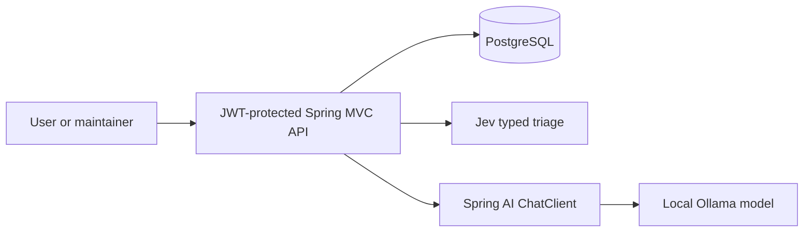

# SpringAI-Jev Issue Triage API

A Java 25 portfolio API for software issues. It stores issues in PostgreSQL, uses Jev for typed category and urgency decisions, and uses Spring AI with local Ollama to draft editable maintainer replies. JWTs protect every route except login.

`USER` accounts submit and read their own issues and triage history. `MAINTAINER` accounts view all issues, run triage, and create, list, or edit drafts. Jev results become `TRIAGED` when category confidence is at least `0.70` and sufficient-information probability is at least `0.60`; otherwise the issue becomes `NEEDS_REVIEW`. These thresholds are provisional until evaluated against labeled issues. Successful results are retained across retries. See the [design specification](docs/superpowers/specs/2026-10-10-issue-triage-api-design.md) for scope and tradeoffs.

Spring AI `ChatClient` handles Ollama reply text. Jev uses its typed HTTP API directly to supply probabilities for the triage rules.

## Architecture and API reference



The [OpenAPI 3.1 contract](docs/api/openapi.yaml) lists every route, request and response schema, authentication requirement, and provider error. It is a static file that can be imported into an OpenAPI viewer; the app does not serve Swagger UI. The Jev call decides category, urgency, and whether enough information was supplied; Java applies provisional review thresholds. Ollama drafts text for a maintainer to edit and never publishes it.

## Run locally

Install JDK 25, Maven 3.9+, Docker with Compose, and [Ollama](https://ollama.com/). Live triage also requires a TypeSafe AI API key.

1. Copy `.env.example` to `.env`. Set `DB_PASSWORD`, `JWT_SECRET` (at least 32 UTF-8 bytes), `TYPESAFE_API_KEY`, `DEMO_USER_PASSWORD`, and `DEMO_MAINTAINER_PASSWORD`. Keep `.env` private.
2. Export the variables and start PostgreSQL:

   ```sh
   set -a; . ./.env; set +a
   docker compose up -d postgres
   ```

3. Start Ollama (`ollama serve` in a separate terminal) and pull the model with `ollama pull gemma3:4b`. On macOS, the [official installer](https://ollama.com/download) provides Ollama.app. If its CLI link could not be created, run `/Applications/Ollama.app/Contents/Resources/ollama` with the same `serve` and `pull` arguments instead.
4. Start the API with `mvn spring-boot:run`.

Flyway creates the schema. Demo accounts are created only when their passwords are supplied. Later changes to those variables do not change existing stored passwords.

## Try the API

The examples use `jq` to extract IDs and tokens from the API on `localhost:8080`.

```sh
USER_TOKEN=$(curl -fsS http://localhost:8080/api/v1/auth/login \
  -H 'Content-Type: application/json' \
  -d "{\"username\":\"demo-user\",\"password\":\"$DEMO_USER_PASSWORD\"}" | jq -r .accessToken)
MAINTAINER_TOKEN=$(curl -fsS http://localhost:8080/api/v1/auth/login \
  -H 'Content-Type: application/json' \
  -d "{\"username\":\"demo-maintainer\",\"password\":\"$DEMO_MAINTAINER_PASSWORD\"}" | jq -r .accessToken)
ISSUE_ID=$(curl -fsS http://localhost:8080/api/v1/issues \
  -H "Authorization: Bearer $USER_TOKEN" -H 'Content-Type: application/json' \
  -d '{"title":"Login fails","description":"Clicking Log in returns HTTP 500 on the account page."}' | jq -r .id)
curl -fsS "http://localhost:8080/api/v1/issues/$ISSUE_ID" -H "Authorization: Bearer $USER_TOKEN"
```

Run Jev triage, then read its history as the owner:

```sh
curl -fsS -X POST "http://localhost:8080/api/v1/issues/$ISSUE_ID/triage" \
  -H "Authorization: Bearer $MAINTAINER_TOKEN"
curl -fsS "http://localhost:8080/api/v1/issues/$ISSUE_ID/triage" \
  -H "Authorization: Bearer $USER_TOKEN"
```

After a successful triage, generate, list, and edit a draft:

```sh
DRAFT_ID=$(curl -fsS -X POST "http://localhost:8080/api/v1/issues/$ISSUE_ID/drafts" \
  -H "Authorization: Bearer $MAINTAINER_TOKEN" | jq -r .id)
curl -fsS "http://localhost:8080/api/v1/issues/$ISSUE_ID/drafts" \
  -H "Authorization: Bearer $MAINTAINER_TOKEN"
curl -fsS -X PATCH "http://localhost:8080/api/v1/issues/$ISSUE_ID/drafts/$DRAFT_ID" \
  -H "Authorization: Bearer $MAINTAINER_TOKEN" -H 'Content-Type: application/json' \
  -d '{"content":"Thanks for the report. Please share the time and request ID so we can investigate."}'
```

Drafts are for maintainer review; the API does not send them to a reporter. JWTs last 30 minutes. Errors use `{ "code", "message", "retryable" }`.

## Test

Run `mvn clean verify` with Docker available. Tests use Testcontainers PostgreSQL and local test doubles for Jev and Ollama; live credentials or Ollama are not needed. The [checkpoint record](codex/checkpoints/01-issue-triage-api.md) lists verification and its limits.
